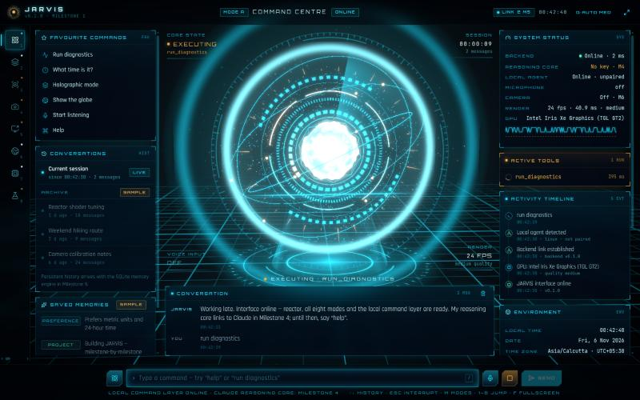
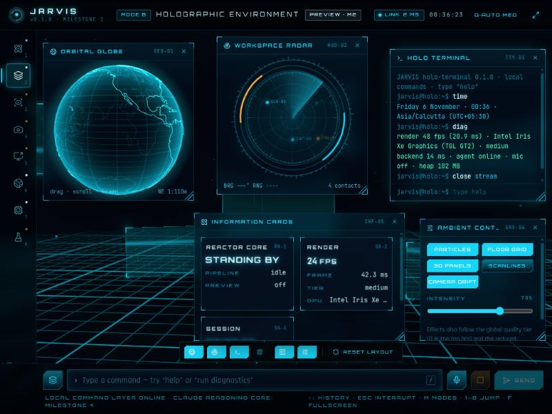
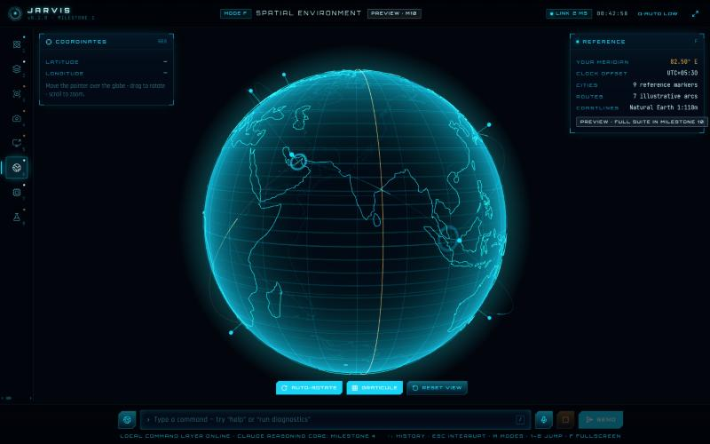
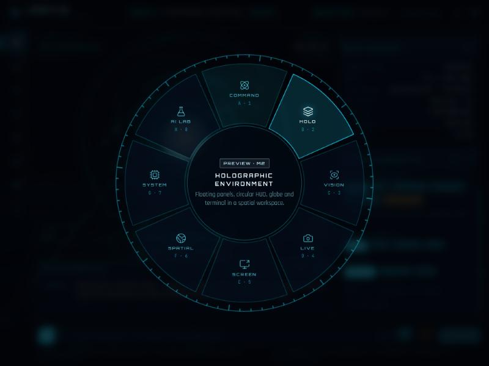
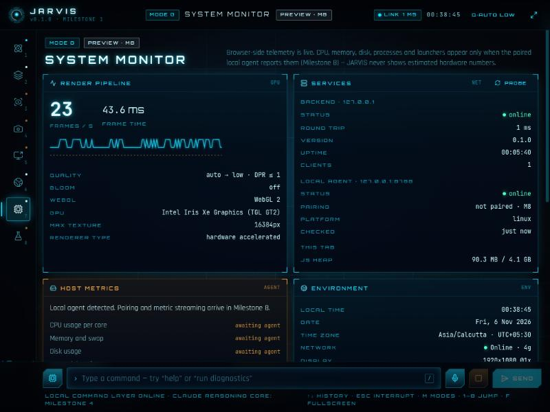

# JARVIS

A personal AI operating environment: a living holographic reactor, a futuristic command centre and
eight interface modes — built milestone by milestone into a Claude-powered assistant with voice,
computer vision, screen understanding, memory and safe local-computer control.



> **Status — Milestone 1 (visual foundation) complete.** The interface, reactor, design system,
> navigation, local command layer, backend link and a hardened local-agent stub are real and
> working. Claude, voice recognition, computer vision and memory arrive in later milestones — see
> [docs/ROADMAP.md](docs/ROADMAP.md). Nothing in the UI fakes data; illustrative entries are
> labelled **SAMPLE**.

## Quick start

Requirements: **Node ≥ 22.12** and **pnpm 10** (`corepack enable pnpm`). A browser with WebGL 2
(Chrome recommended).

```bash
pnpm install
```

```bash
pnpm dev
```

Then open <http://localhost:5173>. `pnpm dev` starts all three apps in parallel:

| App | URL | What it does |
| --- | --- | --- |
| `apps/web` | http://localhost:5173 | The JARVIS interface (Vite dev server; proxies `/api` and `/ws` to the backend) |
| `apps/backend` | http://127.0.0.1:8787 | WebSocket hub + `/api/health`; Claude, tools and memory later |
| `apps/local-agent` | http://127.0.0.1:8788 | Loopback-only bridge to this computer (health only until Milestone 8) |

Configuration is optional — defaults work. To customise, copy the template (never commit `.env`):

```bash
cp .env.example .env
```

Check your environment at any time:

```bash
pnpm preflight
```

## Scripts

| Command | Purpose |
| --- | --- |
| `pnpm dev` | Run web, backend and local agent together |
| `pnpm dev:web` · `pnpm dev:backend` · `pnpm dev:agent` | Run one app |
| `pnpm typecheck` | TypeScript (strict) across all six workspaces |
| `pnpm lint` | ESLint (typescript-eslint, React hooks rules) |
| `pnpm build` | Production builds: Vite for the web app, esbuild bundles for the Node apps |
| `pnpm check` | typecheck + lint + build |
| `pnpm format` | Prettier |
| `pnpm preflight` | Environment check (Node, pnpm, `.env`, disk space, ports) — never prints secrets |

## What works today

| Area | Real in Milestone 1 |
| --- | --- |
| **Reactor** | 3D reactor (shader core, HUD rings, gyroscope rings, GPU orbit particles, shockwaves, projector base, bloom) with five states — idle, listening, thinking, speaking, executing — driven by the real assistant pipeline |
| **Command centre** | Command input with history, streamed responses, interrupt, live microphone visualiser (level/spectrum only — nothing recorded), favourites, activity timeline, tools panel, system status, environment |
| **Local command layer** | “help”, “run diagnostics”, “what time is it?”, “open the vision lab” (any mode), “set quality to high”, “fullscreen”, “start listening”, “clear”, “stop” — each runs through a typed, zod-validated tool registry |
| **Eight modes** | Lazy-loaded with animated transitions, hash URLs (`#/spatial`), back/forward, nav rail, radial mode wheel, hotkeys |
| **Holographic mode** (preview) | Draggable/resizable windows: globe, workspace radar, holo terminal, telemetry stream, 3D info cards, ambient controls |
| **Spatial mode** (preview) | Interactive Earth (Natural Earth coastlines), live pointer coordinates, your time-zone meridian (from the clock — no geolocation) |
| **System mode** (preview) | Truthful browser telemetry; host metrics are shown only once the paired agent supplies them (Milestone 8) |
| **Standby modes** | Vision, Live Vision, Screen Intelligence and AI Lab show their planned capabilities plus *real* readiness checks |
| **Backend / agent** | Typed WebSocket with latency, origin allowlists, rate limits; agent with loopback bind, DNS-rebinding protection and no command execution |

Free-form questions answer honestly that the reasoning core (Claude) lands in Milestone 4.

## Keyboard

| Key | Action |
| --- | --- |
| `/` | Focus the command input |
| `Esc` | Close overlay → interrupt the response → leave the input |
| `1`–`8` | Jump to mode A–H |
| `M` or `Ctrl/⌘ K` | Radial mode wheel (arrows + Enter inside) |
| `F` | Fullscreen |
| `[` `]` | Side panels as drawers (narrow screens) |
| `↑` `↓` | Command history |

## Modes

| | Mode | Status | Full release |
| --- | --- | --- | --- |
| A | Command Centre | Online | Milestone 1 (Claude in M4) |
| B | Holographic Environment | Preview | Milestone 2 |
| C | Vision Laboratory | Standby | Milestone 5 |
| D | Live Vision | Standby | Milestone 6 |
| E | Screen Intelligence | Standby | Milestone 7 |
| F | Spatial Environment | Preview | Milestone 10 |
| G | System Monitor | Preview | Milestone 8 |
| H | AI Laboratory | Standby | Milestone 4 |

<p>
  
  
</p>
<p>
  
  
</p>

## Rendering quality

`auto` (default) starts from a device heuristic — e.g. Intel Iris Xe → **medium** — and steps down
when the frame rate stays low. Pick a fixed tier with the **Q** button in the top bar, the Core
diagnostics panel, or the command “set quality to high”.

| URL parameter | Effect |
| --- | --- |
| `?quality=low\|medium\|high` | Force a tier for this session |
| `?webgl=0` | Force the 2D (SVG) reactor fallback |

Reduced motion follows the OS setting, or override it in Core diagnostics.

## Project layout

```
apps/web          React 19 + Vite 8 + Tailwind 4 + React Three Fiber + Zustand
apps/backend      Express 5 + ws (AI orchestration, tools and memory in later milestones)
apps/local-agent  Loopback-only Node service for approved local operations (M8)
packages/shared   Constants and types shared by every app
packages/schemas  zod contracts: WebSocket protocol, health payloads
packages/ui       Holographic design system — 12 components + tokens + effects
docs/             Architecture, roadmap, design system, screenshots
scripts/          doctor, Node build helper
```

Read [docs/ARCHITECTURE.md](docs/ARCHITECTURE.md) for the full architecture and dependency plan,
and [docs/DESIGN-SYSTEM.md](docs/DESIGN-SYSTEM.md) for the component library.

## Configuration

All apps read one `.env` at the repository root. Highlights (see [.env.example](.env.example)):

| Variable | Default | Notes |
| --- | --- | --- |
| `JARVIS_BACKEND_HOST` / `_PORT` | `127.0.0.1` / `8787` | Non-loopback hosts are refused unless `JARVIS_BACKEND_ALLOW_LAN=true` |
| `JARVIS_WEB_ORIGIN` | `http://localhost:5173,http://localhost:4173` | Origins allowed to use the API / WebSocket |
| `ANTHROPIC_API_KEY` | — | Backend only, used from Milestone 4. Never prefix with `VITE_` |
| `JARVIS_CLAUDE_MODEL` | `claude-opus-5-5` | Model for the reasoning core |
| `JARVIS_AGENT_HOST` / `_PORT` | `127.0.0.1` / `8788` | Loopback only — anything else is refused |
| `VITE_JARVIS_AGENT_URL` | `http://127.0.0.1:8788` | Public (bundled into the browser) |

## Security & privacy

- Secrets stay on the backend; `VITE_*` variables are public by definition.
- Backend and agent bind to loopback; the WebSocket and API accept only allowlisted origins.
- The agent rejects unexpected `Host` headers (DNS-rebinding protection) and non-loopback peers,
  and has **no** command-execution route.
- Microphone audio is analysed in memory only; the camera and screen capture are never touched
  before their milestones, and always behind explicit permission plus a visible indicator.

## Troubleshooting

- **“Link offline” in the top bar** — the backend isn’t running: `pnpm dev:backend`. The web app
  reconnects automatically.
- **Port already in use** — `pnpm preflight` shows which port; stop the other process.
- **Blank or 2D reactor** — the browser lacks WebGL 2 (or hardware acceleration is off). JARVIS
  falls back to the SVG reactor automatically.
- **Low frame rate in an embedded/unfocused browser** — some embedded browsers cap animation at
  ~24 fps while unfocused; `auto` quality then steps down. Use a regular browser window or pin a
  tier.
