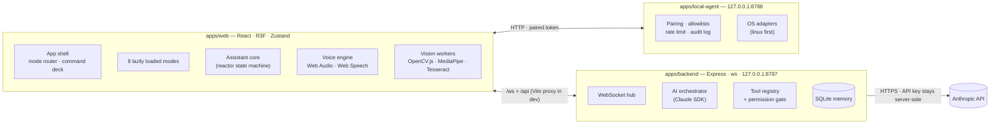

# JARVIS — Architecture & Dependency Plan

> Living document. Updated at the end of every milestone.
> Milestone **1 — Visual foundation** is complete; next is **2 — Graphics engine** (see
> [ROADMAP.md](ROADMAP.md)). Design-system reference: [DESIGN-SYSTEM.md](DESIGN-SYSTEM.md).

## 1. Principles

1. **Real over simulated.** Every visual state maps to an actual application state. Anything mocked is
   labelled `SAMPLE` in the UI and listed in [§13](#13-real-vs-simulated-milestone-1).
2. **Local-first and private.** Camera, microphone and screen capture are opt-in per session, always
   show a visible indicator, and frames are never persisted unless the user explicitly saves them.
3. **Least privilege.** The browser never holds secrets. Claude never executes arbitrary commands.
   The local agent only performs allowlisted operations.
4. **Modular.** Each mode is a lazily loaded feature. Tools, vision models and integrations plug into
   registries instead of being wired by hand.
5. **Performance-aware.** GPU-side animation, adaptive quality tiers, Web Workers for heavy
   computer vision, no per-frame React re-renders.

## 2. Development environment (inspected 2026-11-05)

| Item | Value | Implication |
| --- | --- | --- |
| OS | Linux Mint 22.1 (Ubuntu 24.04 base), x86_64, kernel 6.8 | Linux adapters first for the local agent |
| CPU / RAM | Intel i5-1145G7 (4C/8T), 15 GiB | Vision workers should cap their thread count |
| GPU | Intel Iris Xe (TGL GT2), Mesa 25.2.8, GL 4.6 / GLES 3.2 | WebGL2 is fine; `auto` quality should settle on **medium**; bloom at DPR ≤ 1.5 |
| Node | 22.19.0 (nvm) | Vite 8 requires ≥ 22.12 |
| Package manager | pnpm 10.23.0 (npm 10.9.3, bun 1.4.4 also present) | pnpm workspaces; the content-addressed store saves disk |
| Browsers | Chrome 154, Firefox 156 | Chrome is the primary target (Web Speech recognition, WebGPU) |
| Devices | `/dev/video0–1`, 3 audio capture cards | Live vision and voice are testable locally |
| Disk | **7.7 GB free (97 % used)** | Keep dependencies lean; self-host only the CV models actually used |
| Ports | 5173 / 8787 / 8788 free | web / backend / local agent |

## 3. System overview



**Tool execution routing.** Every tool has an `executor`: `server` (runs in the backend, e.g.
`get_weather`), `client` (runs in the browser, e.g. `start_camera`) or `agent` (runs on the local
agent, e.g. `open_application`). When Claude requests a `client`/`agent` tool, the backend sends a
`tool.execute` message to the browser; the browser enforces the permission tier (confirmation UI for
sensitive tools), calls the local agent with its paired token when needed, and returns a structured
result. This keeps the human-in-the-loop in the UI and means the agent only ever trusts the paired
browser — never the network, never Claude directly.

## 4. Monorepo layout

```
.
├── apps/
│   ├── web/             React + Vite front end (all eight modes)
│   │   └── src/
│   │       ├── app/         shell: top bar, nav rail, command deck, mode stage, mode wheel
│   │       ├── components/  app-level composites (status widgets, reactor glyph, …)
│   │       ├── features/    one folder per mode + memory
│   │       │   ├── command/  holographic/  vision/  live-vision/  screen-intelligence/
│   │       │   └── spatial/  system/  laboratory/  memory/
│   │       ├── hooks/  services/  store/  shaders/  types/  utils/
│   ├── backend/         Express 5 + ws: AI orchestration, tools, memory (SQLite)
│   │   └── src/  api/ ai/ controllers/ services/ tools/ database/ middleware/ websocket/
│   └── local-agent/     loopback-only bridge to the OS (allowlisted operations)
│       └── src/  adapters/ security/ tools/ services/ monitoring/
├── packages/
│   ├── shared/          @jarvis/shared   — constants and types (modes, reactor states, ports)
│   ├── schemas/         @jarvis/schemas  — zod schemas: WS protocol, health, tool contracts
│   └── ui/              @jarvis/ui       — design tokens + holographic component library
├── docs/                architecture, roadmap, design system
└── scripts/             doctor (environment check), node build helper
```

Folders are created when they receive real code; empty placeholder folders are not committed. The
planned home of each later feature is listed in [ROADMAP.md](ROADMAP.md).

**Dependency rules** (enforced by review, cheap to lint later):

- `packages/shared` depends on nothing. `packages/schemas` depends on `shared` + `zod`.
- `packages/ui` depends only on React, Motion and Three/R3F (peer dependencies) — never on an app.
- Apps may depend on packages; **apps never import from other apps**.
- Workspace packages ship TypeScript source (“internal packages”). Vite compiles them for the web;
  `tsx` runs them in development and esbuild bundles them into the Node apps’ `dist/`.

## 5. Front-end architecture

### 5.1 Shell and modes

- **App shell** (`apps/web/src/app`): top bar (identity, mode breadcrumb, link/mic/camera indicators,
  quality, fullscreen), nav rail (all eight modes, `Alt+1…8`), global **command deck** (input, mic,
  interrupt, radial mode wheel), and the **mode stage** that lazy-loads the active mode.
- **Mode registry** (`features/modes.ts`): id, code (A–H), title, icon, hotkey, milestone, status
  (`online` · `preview` · `standby`) and a lazy `import()`. Adding a mode means adding one entry.
- **Routing**: the active mode is mirrored to `location.hash` (`#/vision`), so deep links and
  back/forward work without a router dependency.

### 5.2 State

- **Zustand stores** (`store/`): `ui` (mode, panels, wheel), `core` (assistant state machine),
  `conversation`, `activity` (timeline), `settings` (persisted: quality, motion, persona), `connection`
  (backend link), `devices` (mic/camera status).
- **Signals** (`utils/signal.ts`): high-frequency values (audio level, frame time, pointer) live in
  mutable objects read inside `requestAnimationFrame`/`useFrame`. They never trigger React renders;
  DOM read-outs subscribe at a throttled rate.

### 5.3 Assistant core and reactor states

`idle → listening → thinking → executing → speaking → idle`, with `interrupt` returning to `idle` from
any state. The reactor renders the **effective** state: the core state, or a diagnostics override
(clearly labelled) used to preview animations. Each state is a parameter preset (spin, ring spread,
pulse rate, scan, execution intensity, palette) that the reactor damps towards every frame, so
transitions are continuous and cost nothing in React.

### 5.4 Command pipeline

```
input (text | voice) → interpret()
   ├─ local intent (navigation, diagnostics, time, quality, fullscreen, help)  ← Milestone 1
   └─ Claude (streaming, tool calls)                                           ← Milestone 4
        → tool executions (registry, permission gate) → streamed response → speaking → idle
```

The local intent layer stays after Milestone 4 as a zero-latency fast path for UI commands.

### 5.5 Rendering

- One `<Canvas>` per mode that needs 3D (contexts are disposed on mode exit).
- Quality presets `low · medium · high` (+ `auto`): DPR range, particle counts, bloom, chromatic
  aberration, multisampling, backdrop blur. `auto` starts from a device heuristic (cores, memory,
  software-renderer detection) and is tuned live by drei’s `PerformanceMonitor`.
- Animation runs on the GPU (shader uniforms, vertex-shader orbits); geometries/materials are memoised
  and disposed by R3F on unmount.
- Known limitation (M1): `auto` quality reacts to the `requestAnimationFrame` cadence, so a browser
  that throttles an unfocused/embedded view (observed: ~24 fps with *no* canvas on the page) reads
  as GPU load. Milestone 2 switches the signal to measured GPU time
  (`EXT_disjoint_timer_query_webgl2`).
- `prefers-reduced-motion` (or the in-app override) slows rotation, disables camera drift and
  shortens transitions. No WebGL → an SVG reactor with the same five states.

### 5.6 Design system (`@jarvis/ui`)

Tokens live in a Tailwind v4 `@theme` (void/abyss/navy surfaces, electric cyan, ice, amber warnings;
Orbitron display, Rajdhani UI, JetBrains Mono data). Effects are shared, configurable building blocks
(motion variants, glow levels, corner brackets, scanlines) rather than per-component animation code.

| DOM / SVG components | 3D components (`@jarvis/ui/three`) |
| --- | --- |
| HolographicPanel, HolographicWindow, HolographicButton, HolographicRing, HolographicRadar, HolographicGrid, HolographicText, HolographicDataStream, HolographicScanner, HolographicTerminal | HolographicParticleField, HolographicGlobe, HolographicGridPlane |

## 6. Back-end architecture

- **Express 5 + ws** on loopback. A non-loopback `JARVIS_BACKEND_HOST` is refused at startup unless
  `JARVIS_BACKEND_ALLOW_LAN=true`. `/api/health` (HTTP) and `/ws` (WebSocket).
- **Config**: `.env` at the repo root, validated with zod at boot; secrets never logged (only whether
  `ANTHROPIC_API_KEY` is present is reported).
- **HTTP**: security headers, CORS restricted to `JARVIS_WEB_ORIGIN` (comma-separated;
  `localhost` ⇄ `127.0.0.1` equivalent), 64 KB body limit, per-address rate limit, request timeouts.
- **WS hub**: Origin allowlist check on upgrade (prevents cross-site WebSocket hijacking), typed
  messages (`@jarvis/schemas`), per-connection token-bucket rate limit, ping/pong latency, heartbeat
  with dead-connection termination. Invalid messages get a typed `error`.
- **Planned** (`ai/`, `tools/`, `database/`, `controllers/`): the AI orchestrator (M4), the tool
  registry and permission gate (M4), SQLite memory (M9), rate limiting on AI and vision endpoints.

## 7. Local agent

- Binds to loopback only; non-loopback hosts are refused at config validation.
- **DNS-rebinding protection**: rejects requests whose `Host` is not `127.0.0.1:<port>` or
  `localhost:<port>`; rejects non-loopback peers; CORS restricted to the configured web origin.
- **Planned (M8)**: pairing (one-time code printed in the agent terminal → short-lived token stored
  by the browser), allowlists (`apps`, `directories`, `scripts` in a user-owned config file — ids, never
  raw paths), confirmation tiers, per-operation timeouts, token-bucket rate limiting, JSONL audit log,
  `PlatformAdapter` interface with `linux` first (`xdg-open`, `.desktop` launchers,
  `systeminformation`), then `darwin`/`win32`.

## 8. AI brain (Claude) — plan for Milestone 4

- **SDK** `@anthropic-ai/sdk` 1.x, used **only** in `apps/backend`. Auth from `ANTHROPIC_API_KEY`
  (the SDK also picks up an `ant auth login` profile). Keys never reach the browser, logs or the DB.
- **Model**: default `claude-opus-5-5`, configurable via `JARVIS_CLAUDE_MODEL` and the AI Laboratory.
  On Opus 5.5 adaptive thinking is always on; **effort** is the control (its default is `medium`, so
  it is set explicitly per route). No forced `tool_choice` (use `auto` + `strict: true` tools), no
  sampling parameters (`temperature`/`top_p`/`top_k` are rejected), no assistant prefill.
- **Streaming**: `client.messages.stream()`; text deltas and tool events are forwarded over the
  WebSocket; `finalMessage()` provides the record that gets persisted.
- **Tool loop**: owned by the backend (not the SDK runner) so the permission gate can pause for
  browser confirmation. Tool input schemas are generated from zod; inputs are validated before any
  handler runs; parallel tool results go back in one message; failures return `is_error: true`.
- **Safety and robustness**: check `stop_reason` (`refusal`, `max_tokens`) before reading content;
  server-side refusal fallbacks enabled by default; typed SDK errors map to UI states (missing key,
  rate limited, offline).
- **Context**: stable system prompt (persona) and a deterministic tool list first for prompt
  caching; volatile context (time, mode, retrieved memories) after the last cache breakpoint;
  server-side compaction for long sessions.
- **Vision**: base64 image blocks, downscaled and JPEG-encoded in the browser; frames are sent only
  on an explicit request (“what am I looking at?”), never continuously.

## 9. Vision pipeline (Milestones 5–7)

| Task | Library | Where it runs |
| --- | --- | --- |
| Filters, edges, Canny, threshold, contours, segmentation, histograms, resize/rotate | OpenCV.js (WASM) | Dedicated Web Worker, lazy-loaded on first use |
| Object/face detection, face/hand/pose landmarks, gestures | MediaPipe Tasks Vision (GPU delegate) | Main thread (video) or worker (`OffscreenCanvas`), 640×480 input, frame-skipping under load |
| OCR | Tesseract.js | Its own worker; language data self-hosted |
| Semantic understanding (“describe”, “explain this error”, “compare”) | Claude vision via the backend | On demand only |

Face detection never becomes identification: no face embeddings, no recognition of unknown people.

## 10. Voice pipeline (Milestone 3)

- **Audio state machine**: `idle → listening → processing → speaking`, plus `interrupted`.
- **Input**: `getUserMedia` (echo cancellation, noise suppression, AGC) → `AnalyserNode` → level and
  spectrum signals (the reactor reacts to the real microphone). Milestone 1 already ships this.
- **Recognition**: Web Speech API where available (Chrome sends audio to a cloud service — disclosed
  in the UI); optional Whisper adapter (local `whisper.cpp` server or API) behind one
  `SpeechRecognizer` interface.
- **Synthesis**: `SpeechSynthesis` with voice/rate selection; boundary events drive the speaking
  envelope (browsers do not expose TTS audio samples).
- **Wake word**: a separate, disabled-by-default `WakeWordEngine` interface (e.g. an on-device
  openWakeWord/Porcupine WASM model). Not claimed via the Web Speech API.

## 11. Security & privacy model

| Threat | Mitigation |
| --- | --- |
| API key exposure | Server-side only; `VITE_*` vars are public by definition and never hold secrets |
| Cross-site WebSocket hijacking | Origin allowlist on the backend WS upgrade |
| DNS rebinding against localhost services | `Host` header allowlist + loopback bind + loopback peer check |
| Arbitrary command execution | No shell tool; allowlisted ids only; scripts by id with fixed arguments |
| Arbitrary filesystem access | Directory ids from the allowlist; paths resolved and checked server-side |
| Silent capture | Explicit start per session, visible indicators, streams stopped on mode exit/unmount |
| Data retention | Frames/screenshots in memory only; persistence is an explicit user action; memory screen allows deletion |
| Prompt injection via screens/images | Tool calls from model output still pass the permission gate; sensitive tools always confirm |

## 12. Performance strategy

Lazy-loaded modes and a separate Three.js chunk; GPU-driven animation; memoised and disposed GPU
resources; adaptive DPR and quality; Web Workers for CV/OCR; camera capped at 640×480 / 30 fps with
frame skipping; streams and audio contexts cleaned up on unmount; a live FPS/frame-time monitor in the
UI.

## 13. Real vs. simulated (Milestone 1)

| Feature | Status |
| --- | --- |
| Reactor states, transitions, audio reactivity (microphone) | **Real** — states come from the assistant pipeline; the diagnostics “preview” override is labelled in the HUD |
| THINKING / EXECUTING durations | Real work, held for a short perceptual minimum (420 / 600 ms) so instant local commands stay legible |
| Speaking envelope | Derived from the streamed response text (until TTS lands in M3) |
| Local commands: navigation, time, diagnostics, quality, fullscreen, microphone, clear, help | **Real** (zod-validated tool registry, timed tool runs) |
| Free-form questions | Answered honestly as “reasoning core offline until Milestone 4” |
| Activity timeline, render FPS, GPU info, environment, backend link + latency | **Real** |
| Local agent status | **Real** health probe (pairing and tools arrive in M8) |
| Holographic mode: terminal, telemetry stream, radar contacts, info cards, ambient controls | **Real** (radar contacts are the open windows) |
| Spatial mode: reference cities, time-zone meridian, hover coordinates | **Real** coordinates; the routes between cities are illustrative |
| Conversation archive, saved memories (left panel) | `SAMPLE` data until M9 |
| CPU / memory / disk / processes | **Not shown** until the local agent provides real numbers (M8) |

## 14. Dependency plan

Versions are the latest compatible releases on 2026-11-05 (exact resolutions in `pnpm-lock.yaml`).

### Installed in Milestone 1

| Package | Version | Workspace | Purpose |
| --- | --- | --- | --- |
| typescript | 6.0.3 | root | Type checking. **Not 7.0**: TS 7 is the native compiler without the JS API that typescript-eslint needs (`<6.1`) |
| eslint · @eslint/js · typescript-eslint · eslint-plugin-react-hooks · globals | 10 · 10 · 8.72 · 7.1 · 17 | root | Linting (rules-of-hooks, exhaustive-deps) |
| prettier | 3.9 | root | Formatting |
| esbuild | 0.28 | root | Bundles the Node apps (workspace packages inlined) |
| @types/node | 22.x | root | Matches the Node 22 runtime |
| react · react-dom | 19.3.1 | web, ui | UI runtime (R3F 9 supports `<19.4`) |
| vite · @vitejs/plugin-react | 8.3 · 6.2 | web | Dev server and build |
| tailwindcss · @tailwindcss/vite | 4.3 | web | Utility CSS with `@theme` tokens |
| motion | 14.9 | web, ui | Framer Motion (now published as `motion`) |
| three · @types/three | 0.187.0 | web, ui | WebGL engine. Pinned `<0.188` by `postprocessing` |
| @react-three/fiber · @react-three/drei | 9.8 · 10.7 | web, ui | React renderer for Three + helpers |
| @react-three/postprocessing · postprocessing | 3.2 · 6.39 | web | Bloom, vignette, chromatic aberration |
| zustand | 5.0 | web | State stores |
| lucide-react | 1.x | web | Line icons |
| @fontsource/rajdhani · @fontsource-variable/orbitron · @fontsource-variable/jetbrains-mono | 5.3 | web | Self-hosted fonts (no third-party font requests) |
| world-atlas · topojson-client | 2.0 · 3.1 | ui | Natural Earth 110m coastlines for the globe (lazy-loaded) |
| express · ws | 5.3 · 8.22 | backend | HTTP + WebSocket server |
| zod | 4.6 | schemas, backend, agent | Runtime validation and inferred types |
| tsx | 4.23 | backend, agent | TypeScript execution in development |

### Planned (installed in the milestone that uses them)

| Package | Version today | Milestone | Notes |
| --- | --- | --- | --- |
| @anthropic-ai/sdk | 1.5 | 4 | Backend only |
| better-sqlite3 | 13.0 | 9 | Synchronous SQLite; `node:sqlite` is the fallback if native builds become a problem |
| @techstark/opencv-js | 5.0.0-release.1 | 5 | ~10 MB WASM, worker-only, lazy |
| tesseract.js | 7.0 | 5 / 7 | OCR worker; language data self-hosted |
| @mediapipe/tasks-vision | 1.2 | 6 | Models self-hosted under `public/models` |
| systeminformation | 5.33 | 8 | Local agent system metrics |
| pdfjs-dist | 6.5 | 10 | Document intelligence (experimental) |

## 15. Key decisions

| Decision | Why |
| --- | --- |
| pnpm workspaces | Already installed; strict dependency boundaries; shared store matters with 7.7 GB free |
| Internal TS-source packages | No build step for packages; one source of truth; Vite/tsx/esbuild compile on demand |
| TypeScript 6.0, not 7.0 | Keeps typescript-eslint working; revisit when it supports TS 7 |
| Hash-synced mode state instead of a router | Eight flat modes; deep links and history without another dependency |
| One Canvas per 3D mode | Simple lifecycle and disposal; no cross-mode GPU work |
| Local intent layer before Claude | Real, instant UI commands now; remains the fast path later |
| Browser mediates agent tools | Human-in-the-loop confirmation lives in the UI; the agent trusts only the paired browser |
